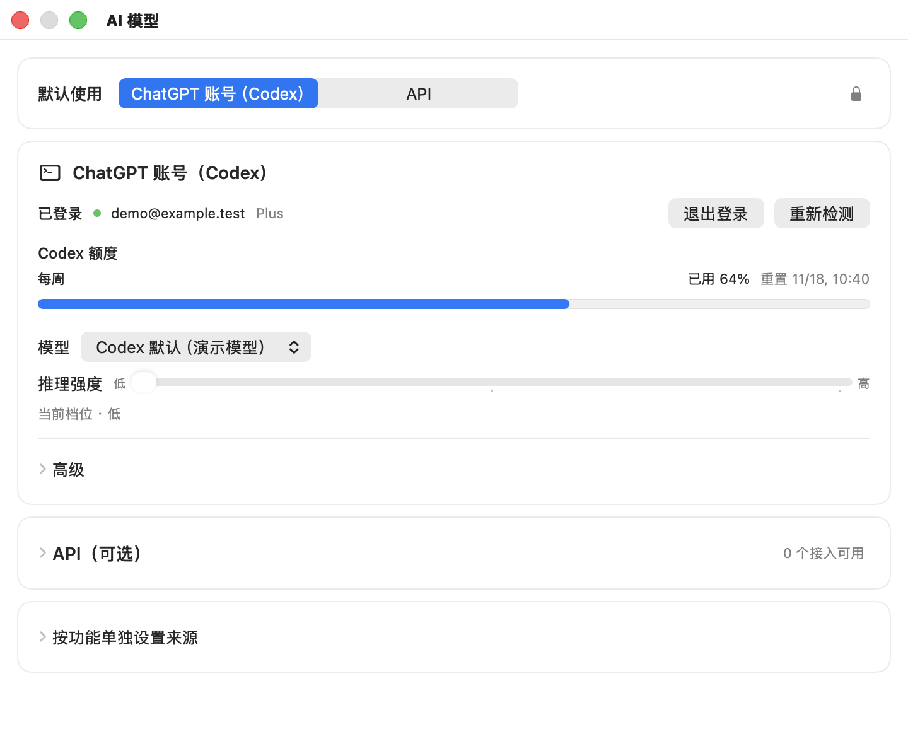
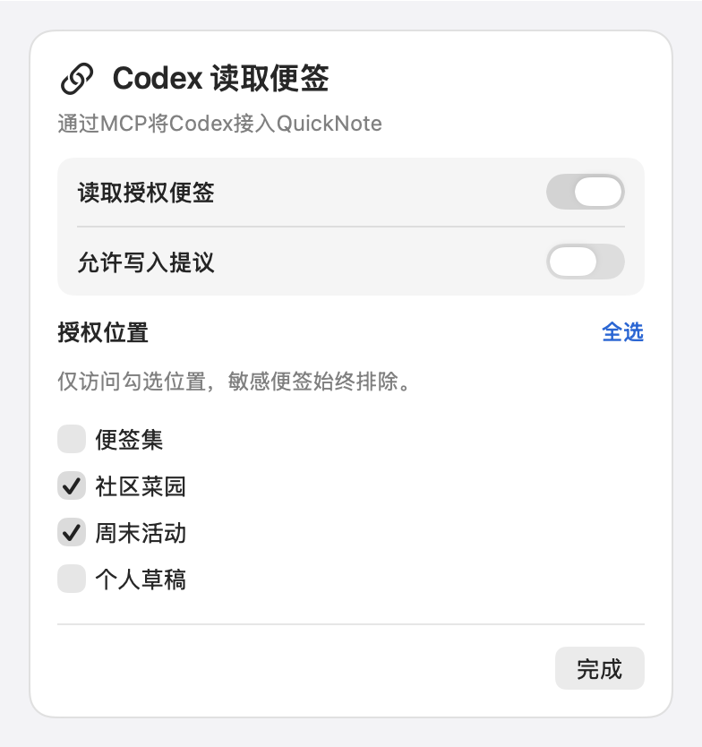
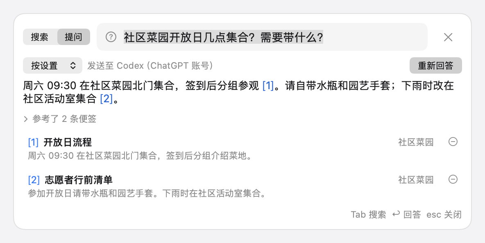
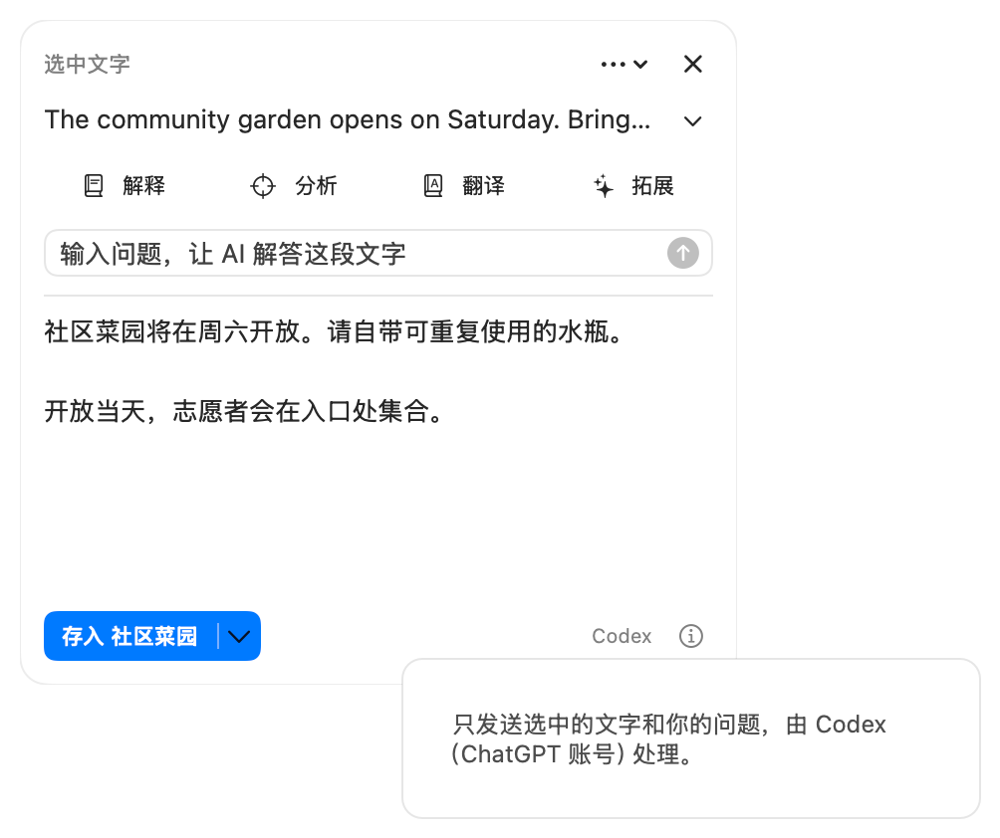
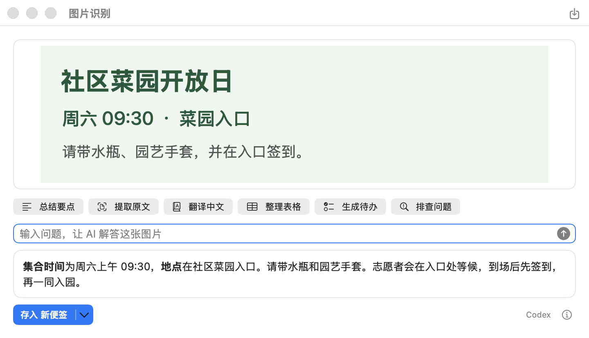

# QuickNote

**本地优先的原生 macOS 便签。** 双击 Command 随手记，按 Option + Space 处理选中的文字，按 Command + Shift 框选屏幕识图。在本机查找旧笔记，或让 AI 根据相关片段回答并标出原文。

支持 **macOS 14+**。GitHub 仓库名为 `QuickNote-IOS`，当前发布的是 macOS 应用。[项目介绍与演示](https://www.huangxiyuan.net/projects/quicknote)

## 两个方向接入 Codex

| 从哪里使用 | 可以做什么 |
|---|---|
| **QuickNote → Codex** | 在「设置 → AI 模型」选择 ChatGPT 账号（Codex）。安装本机 Codex CLI 后可使用已有 ChatGPT 登录，无需填写 API Key。支持划词、自定义问题、截图识图、AI 排版、语音转写后整理，以及问我的便签。 |
| **Codex → QuickNote** | 通过本机 MCP，在 Codex 中搜索获授权的便签，从搜索结果打开正文。可选开启新建或追加提议，每条提议都在 QuickNote 内确认后写入。 |



QuickNote 会检测 CLI 路径与登录状态，可打开官方登录页面，读取 Codex 返回的模型、推理档位及额度。可按功能选择 Codex、已配置的 API 或支持文字处理的 Apple 本机模型。额度只展示 Codex 实际返回的窗口。QuickNote 发出的模型请求使用临时会话，禁用命令执行和 MCP 工具。

### 让 Codex 读取指定便签

1. 在 QuickNote 里打开「设置 → Codex 读取便签」，开启「读取授权便签」，勾选允许访问的文件夹或「便签集」。**敏感便签始终排除。**
2. 在终端注册随应用构建的 MCP 工具。下例使用 `/Applications` 安装路径。

   ```sh
   codex mcp add quicknote -- /Applications/QuickNote.app/Contents/MacOS/quicknote-mcp
   ```

3. 保持 QuickNote 打开，在 Codex 的新会话里搜索便签，并请它打开你指定的结果。读取正文时以 Markdown 和附件占位符呈现。需要写入时，在 QuickNote 打开「允许写入提议」，再到应用里审核和确认。



## 在本机找回旧笔记

- **全文搜索**覆盖标题、正文和标签，显示命中片段与所属文件夹，可用键盘在同一便签的不同命中之间切换。
- **问我的便签**从搜索面板按 Tab 进入。QuickNote 在本机检索相关片段，再由所选模型回答。点击回答里的引用可回到对应便签和原文位置。敏感便签排除在提问检索之外。



## 从文字、图片和语音到便签

- **划词 AI**支持解释、分析、翻译、拓展与自定义问题。可拖动面板标题或空白处，结果底栏可换存入目标，ⓘ 显示发送范围和处理来源。
- **截图识图**有六条快捷指令，包括提取原文、翻译、整理表格与生成待办。也能直接提问。预览保持图片比例，结果出现时窗口向下展开。图片和结果可分别存入便签。
- **语音记录**先在 Mac 上转写，离线模型可用时做增强复核。录音结束可用所选模型自动整理本次转写，失败时保留原文。语音面板可开启整理前确认。
- **AI 排版**先生成可预览的排版方案，在应用内确认后应用。便签支持富文本、标题、表格、清单、附件、文件夹、主题和版本记录。

| 划词结果和来源说明 | 截图识图结果 |
|---|---|
|  |  |

以上截图均使用合成便签、账号和演示结果。

## 数据留在哪里

便签与附件保存在本机 `~/Library/Application Support/QuickNote/`，API Key 由 macOS 钥匙串保护。基础编辑、全文搜索和离线语音转写可以在本机完成。

调用模型时，界面会显示处理来源。**本机 Codex 指本机运行的 CLI**，使用 ChatGPT 账号时模型请求仍由 ChatGPT 服务处理。问便签发送本次问题及检索片段，语音整理发送本次转写文字。MCP 读取范围与模型来源分别配置。

## 从源码构建

需要 macOS 14+、Xcode 与 [XcodeGen](https://github.com/yonaskolb/XcodeGen)。离线语音模型由脚本按需下载并校验，首次约 230 MB。

```sh
brew install xcodegen
bash scripts/prepare-offline-speech.sh
xcodegen generate
xcodebuild build -project QuickNote.xcodeproj -scheme QuickNote \
  -configuration Release -derivedDataPath /tmp/QuickNoteDerived
open /tmp/QuickNoteDerived/Build/Products/Release/QuickNote.app
```

上面的构建适合本地试用。若要用同一签名身份持续升级，请设置本人的 `QUICKNOTE_SIGNING_IDENTITY` 和 `QUICKNOTE_DEVELOPMENT_TEAM`，再运行 `./scripts/verify-p0.sh`。首次使用快捷键、划词或截图时，请按系统提示授权输入监控、辅助功能与屏幕录制。

离线模型及原生运行时的许可证位于 `QuickNote/Resources/Speech/`。
